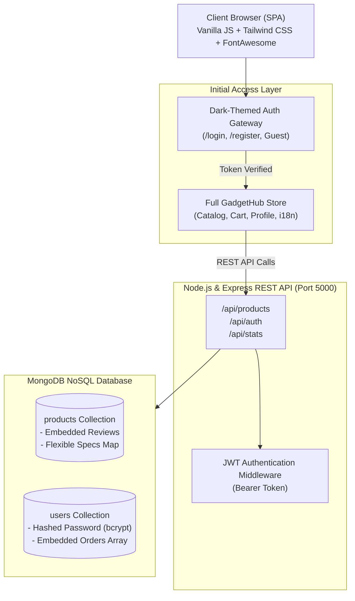

# ⚡ GadgetHub - Document-Driven NoSQL E-Commerce Platform

A production-grade, full-stack E-Commerce catalog and gadget management web application built with **Node.js**, **Express**, **MongoDB (NoSQL)**, **Mongoose**, **Vanilla JavaScript**, and **Tailwind CSS**.

GadgetHub showcases real-world document database design patterns (embedded documents and flexible schemas), secure JWT authentication with an initial dark-themed gateway, multilingual localization (English, Hindi, Bengali), and an Amazon-grade interactive product interface.

---

## 🌟 Key Highlights & Features

### 1. 🔐 Initial Dark-Navy Authentication Gateway
- **Sleek Initial Screen:** Clean, dark-mode entry portal (`#0e1424` backdrop with glowing radial light, `#1a2237` card, cyan-to-blue gradient action buttons) inspired by modern AI interfaces.
- **Client-Side Routing:** Direct route support for `/login` and `/register`.
- **Security:** Passwords securely hashed with **bcryptjs** (10 salt rounds); stateless authentication powered by **JSON Web Tokens (JWT)**.
- **User Profile & Order History:** Embedded NoSQL order tracking, editable profile details, and persistent login via `localStorage`.
- **Guest Access & Demo Mode:** One-click demo credentials (`priya@gadgethub.com` / `password123`) and a guest exploration bypass.

### 2. 🍃 Document-Oriented NoSQL Design (MongoDB)
- **Embedded Document Pattern:** Customer reviews are embedded directly within each product document (`reviews: [ReviewSchema]`), eliminating slow relational JOINs.
- **Flexible Schema Architecture:** Dynamic technical specifications are stored as a key-value Map (`specs: { type: Map, of: String }`), allowing varied attributes across smartphones, laptops, audio gear, and wearables.
- **Embedded User Orders:** Completed checkout orders are stored directly inside the user's document for rapid retrieval.

### 3. 🌐 Multilingual Support (i18n)
- Seamless real-time language toggling between:
  - 🇬🇧 **English**
  - 🇮🇳 **Hindi (हिंदी)**
  - 🇮🇳 **Bengali (বাংলা)**
- Instant script transformation across navbar items, category pills, filter labels, product cards, technical specifications, and modal controls without reloading.

### 4. 🛒 Amazon-Style Interactive UI & Live Reviews
- **3-Column Amazon Layout:** High-resolution product showcase, pricing breakdowns with deals, EMI options, and partner discounts.
- **Internet Community Reviews:** Real curated reviews from tech forums, verified buyer benchmarks, and interactive star ratings.
- **Shopping Cart & Checkout:** Persistent client-side cart, subtotal calculation, free shipping logic, and simulated checkout that saves orders to MongoDB.
- **Full CRUD Support:** Add, edit, search (regex-based across name, brand, description), filter by price range and stock, and delete gadgets.

---

## 🏗️ System Architecture



---

## 📊 Database Schema Design

### Products Collection (`Product.js`)
```javascript
{
  name: String,            // e.g. "Apple iPhone 15 Pro Max"
  brand: String,           // e.g. "Apple"
  category: String,        // Smartphones, Laptops, Audio, Wearables, Gaming
  price: Number,           // Numeric price in INR
  inStock: Boolean,        // Stock availability
  imageUrl: String,        // CDN / Web Image URL
  description: String,     // Product overview
  specs: Map of String,    // Dynamic key-values: { "RAM": "8GB", "Chip": "A17 Pro" }
  reviews: [               // Embedded NoSQL Array
    {
      author: String,
      rating: Number,
      comment: String,
      createdAt: Date
    }
  ]
}
```

### Users Collection (`User.js`)
```javascript
{
  name: String,            // User full name
  email: String,           // Unique, indexed email address
  password: String,        // Bcrypt hashed password (10 rounds)
  phone: String,           // Contact phone
  address: String,         // Default shipping address
  orders: [                // Embedded NoSQL Orders Array
    {
      orderId: String,
      items: Array,
      totalAmount: Number,
      shippingAddress: String,
      status: String,
      createdAt: Date
    }
  ]
}
```

---

## 🔌 REST API Reference

| Method | Endpoint | Description | Auth Required |
|---|---|---|---|
| `GET` | `/api/products` | Retrieve catalog (supports `search`, `category`, `minPrice`, `maxPrice`, `inStock`, `sort`) | No |
| `GET` | `/api/products/:id` | Get single product document with embedded reviews | No |
| `POST` | `/api/products` | Insert new gadget document | No |
| `PUT` | `/api/products/:id` | Update existing gadget details and specifications | No |
| `DELETE` | `/api/products/:id` | Remove gadget from catalog | No |
| `POST` | `/api/products/:id/reviews` | Append review to embedded `reviews` array | No |
| `POST` | `/api/auth/register` | Register new user account with hashed password | No |
| `POST` | `/api/auth/login` | Authenticate user credentials and issue JWT token | No |
| `GET` | `/api/auth/me` | Fetch authenticated user profile and past orders | Yes (JWT) |
| `PUT` | `/api/auth/profile` | Update user name, phone, address, or password | Yes (JWT) |
| `POST` | `/api/auth/orders` | Record checkout order inside user's `orders` array | Yes (JWT) |
| `GET` | `/api/stats` | Aggregate catalog metrics (total gadgets, reviews, categories) | No |

---

## 🚀 Quick Start Guide

### Prerequisites
- [Node.js](https://nodejs.org/) (v16.0 or higher)
- [MongoDB Community Server](https://www.mongodb.com/try/download/community) running locally on port `27017`

### 1. Installation
Clone the repository and install dependencies:
```bash
git clone <your-github-repo-url>
cd "CREATE USING UR WEBSITE USING NOSQL"
npm install
```

### 2. Environment Configuration
Create a `.env` file in the project root:
```env
PORT=5000
MONGODB_URI=mongodb://127.0.0.1:27017/gadgethub
JWT_SECRET=gadgethub_jwt_super_secret_key_2026
```

### 3. Seed Database
Populate the database with 14 curated high-tech gadgets and the verified demo account:
```bash
node seed.js
```

### 4. Start Server
```bash
npm start
```
Open **`http://localhost:5000`** in your browser.

---

## 🔑 Demo Account Credentials
- **Email:** `priya@gadgethub.com`
- **Password:** `password123`
*(Or click the "Use Demo Account" quick-fill button on the login screen).*

---

## 📂 Project Structure

```
├── models/
│   ├── Product.js          # Mongoose schema with embedded reviews & dynamic specs
│   └── User.js             # Mongoose schema with bcrypt hashing & embedded orders
├── public/
│   ├── index.html          # Single-Page UI with Dark Navy Auth Gate & Amazon Modals
│   └── app.js              # State manager, i18n engine, routing, cart & API calls
├── .env                    # Environment variables
├── package.json            # Dependencies and scripts
├── seed.js                 # Sample database seeder
├── server.js               # Express server, JWT middleware & REST API
└── README.md               # Project documentation
```
